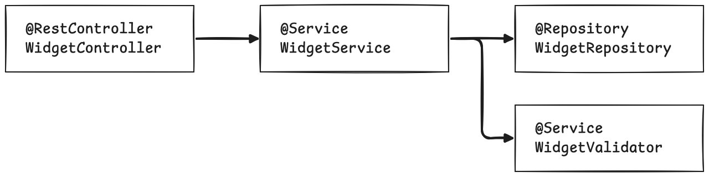

= The value of Spring Boot-specific test tooling
:source-highlighter: rouge
:icons: font
:tabsize: 2

[.normal]
Testing applications and verifying that they have the intended behavior is an unavoidable aspect of the development lifecycle.
This is true for all types of applications, web, mobile, desktop or embedded, whether they're written in Java, in Javascript, in Erlang or in COBOL.
And if you, as a developer, don't test explicitly, someone will.
Hopefully, that someone is a colleague who is part of your software development process, and not your end-users.

In any serious software engineering project, automating at least part of these tests is table stakes.
You do not want to be clicking buttons manually everytime you make a change.
If you picked up this book, chances are you have already implemented extensive testing yourself, and you do not need to be convinced that you should, in fact, write tests.

In the case of a regular web application, whether it was developed using Spring Boot or some other technology, there are many types of tests you can write.
They can be very low-level, centered on tiny pieces of business logic, focusing on a few classes or methods: those are unit tests.
On the other end of the spectrum, you can deploy your application in a dedicated test or staging environment, and run a testing program against this running app.
Those are sometimes called integration tests, or end-to-end tests.
And there is a continuum of types of tests in between.
Each "testing level" has its own advantages and drawbacks, as well as specific tooling associated to it.

In this chapter, we will discuss the tools that Spring and Spring Boot can offer to simplify testing.
You will discover where on the testing spectrum these tools shine, and how they outperform manually crafting those tests.

[NOTE]
This book is not a general-purpose book on tests.
It is focused on Spring applications, and assumes passing familiarity with testing.
There are countless resources both in print and online.
If you have never written a test before, you should get familiar with those resources before focusing on Spring-specific content.

== The challenges of testing Spring Boot applications

We've discussed two types of tests in the introduction.

Unit tests are the backbone of software testing, and they come with great porterties:

- They are fast to run: clicking a button for a given test will give you feedback within tens or hundreds of milliseconds.
- They are isolated and test a small piece of code, a specification or algorithm.
A failing test points you to a specific failure.
- You can control the inputs of every test with minimal friction, by wiring classes manually, and introducing stubs and mocks in your dependency graph.
This, in turn, allows you to create test suites that verify that every line of code and every conditional branch are executed, and that the outputs match your expectations.
- Because they do not require dependencies like databases or external services, unit tests are usually very deterministic.
A failure is a sign of an issue in your production code.
- You can mock dependencies and simulate complex error conditions with relative ease.

However, their narrow focus on classes or methods comes with an important caveat: they will not give you full confidence that the program as a whole behaves correctly, that the components interact in the expected ways, and that you have used the framework correctly.
For example, using raw unit tests, you cannot easily verify that a Spring `@ControllerAdvice` is triggered when your users perform a web request with certain parameters.

End-to-end tests address those limitations, and ensure that the system as whole works as intended.
But they come with significant drawbacks:

- Before you can execute the tests, you need to actually run the application under tests, usually in a dedicated environment.
You can run the application locally on your developer machine, but this requires setting up and maintaining the required dependencies, such as databases, message queues or external systems.
You may need to stub some of those system, for example by providing fake APIs with pre-determined responses.
- They are less deterministic by nature.
You need to take a lot of side effects and asynchronous behavior into account.
For example, if you are testing through a browser and a webdriver, you will often need to "wait until this or that element is visible".
- Because they test the full depth of the program, you need to set up a lot of state to exercise a specific behavior.
For example "GIVEN The user is logged in, AND they have three Widgets in their basket, AND they have a membership card, AND they have bought at least five Doodads in the past six months BUT they never had a GoldenSale discount, THEN they have access to a GoldenSale 10% discount".
This may result in many API calls just to bootstrap the state of your application before any given test.
- You do not have access to the internals of the application, and you need to write a lot of code to verify behavior.
Following up on the previous example above, to verify that the user has exercised the GoldenSale discount, you need to navigate to the order history, find the appropriate order, open the page, and then verify that a "GoldenSale" badge is displayed.
And since you cannot manipulate internal state, you have no shortcut to set up the state of the program.
For example, you can't just write "The user is eligible to a GoldenSale discount".
- They are much slower to execute.
They go through more setup, require more dependencies to start, and exercise more code.
As a result, you run them much more infrequently.

There is a gap between these two ends of the testing spectrum.
Ideally, you would have some tooling to run _most_ of the stack of your application, but swap out some complex pieces on demand.
For example, you want to run the full app, including the database, but stub out the external "Payment Service" which is too difficult to run locally.

This is where Spring and Spring Boot come in.

== The need for Spring-specific tooling

The Spring Framework provides powerful abstractions to connect different parts of an application together.
With those abstractions, you can easily resolve component dependencies, decide which flavor of a specific interface should be used in some specific cases, turn off some components, etc.
Through the `ApplicationContext`, you can discover, access and manipulate the "beans", or component instances, used throughout the application.
Using those abstractions, you can create your own "test application" that look a lot like your production application, programmatically run the app, and interact with the created beans.
But if you tried to use the Spring Framework to do this manually, you would end up writing a lot of boilerplate code.
You would also face specific testing challenges managing multiple configurations for different tests.
To make sense of the code you would need to write, let's examine an example.

The application is a fairly simple app, responsible for handling Widgets.
Users interact with it through a `@RestController`, and data is ultimately stored in `@WidgetRepository`.
The `WidgetValidator` service represents an external service, used to validate Widgets before they are stored.
It has complex logic, and is difficult to run on a developer machine, so you want to avoid running it locally.
However, the Java API is fairly simple, `void validate(Widget widget)` method that throws a specific exception when there is a validation error.

Let's imagine a world in which Spring Boot does not have any specific tooling for writing tests.
What would it take to run tests against our application, without the `WidgetValidator`?

[WARNING]
Of course, this book is all about what Spring Boot _actually_ provides in terms of testing.
This example is an anti-pattern, only showcased for educational purposes.
Please don't do this in your own test code!

First, let's assume you have a running application that you can write your tests against, without worrying about all the boilerplate required to make it work.
Let's outline a simple test:

[source,java]
----
include::../samples/ch1/widget/src/test/java/wf/garnier/spring/boot/test/ch1/widget/test/manual/ManualSpringBootTests.java[tags=content;!before-after;!configuration;!ignored]
----

<1> This is the `ApplicationContext` of the application you are testing, referencing all beans, properties, etc.
<2> The `RestClient` is the HTTP client we will be using to make HTTP calls to the test instance of our application.
<3> The actual test, everything in this method is the logic for your test.
<4> Obtain references to bean instances in the running application with `.getBean()`.
<5> Using the `RestClient`, make HTTP requests, specifying the header, body, etc.
<6> Verify that the HTTP response code is `201 CREATED`.
<7> Verify that the widget is in the repository, with the correct properties.

This is just the testing logic itself.
A few observations:

- You will need to write a lot of boilerplate code just to hook up the `ApplicationContext` and `RestClient` fields of the test class, in the "setup" phase of the test.
You need to specify which beans go into the application context, and you need to know the URL at which the running application can be reached in order to use the rest client.
- You can access beans programmatically through the `ApplicationContext`, but not using the familiar Spring Boot idioms.
This allows you to interact with live instances of your beans, such as the `WidgetRepository`, or to configure your fake objects to return pre-determined responses, such as the `WidgetValidator`.
- The HTTP requests you make need to match real-world HTTP requests, with the correct headers, body, etc.
It is essentially close to production code, with no syntactic sugar for testing.

The test as is cannot run on its own, and you need to write some boilerplate code.
There are two parts to the setup.
First, you need to define a "test" application, by describing what is included from your production code, and what beans should be replaced by test-specific classes.
Then, you need to start and stop this application, and connect your tests to it.
In an ideal word, you would just write another class and annotate it with `@SpringBootApplication`.
But this wouldn't work here, because it would conflict with your production main class.
Another drawback is that you would not have enough control on what gets loaded in the context exactly.
This quickly leads to complicated configurations, like so:

[source,java]
----
include::../samples/ch1/widget/src/test/java/wf/garnier/spring/boot/test/ch1/widget/test/manual/ManualSpringBootTests.java[tags=content;!class-members;!before-after;!test;!ignored]
----

<1> Enable Spring Boot auto-configuration
<2> Turn on annotation-based configuration, which picks up all your `@Component`, `@RestController`, etc, classes.
Configure it to pick up a narrow scope.
<3> Provide own stub implementation of `WidgetValidator`.

This shows the complexity of dealing with a "test-only" application, that is close to the real production application but not quite.
Specifically, you need to exclude the `@SpringBootApplication` main class, so that you control exactly what goes into your test.
Otherwise, the default Spring Boot behavior would kick in and bring in more thant what you need.
You need to replace the `WidgetValidator` with a test implementation, in two phases: exclude the production code from component scanning, and include your own bean, so that only one instance is loaded in the test application.

While this describes the application you want to test, it does not start it per se.
To do so, you need to configure some setup code, and the associated teardown code to stop the application

[source,java]
----
include::../samples/ch1/widget/src/test/java/wf/garnier/spring/boot/test/ch1/widget/test/manual/ManualSpringBootTests.java[tags=content;!configuration;!test;!ignored]
----

<1> The configuration is loaded into a `SpringApplicationBuilder`, along with some properties overriding the default `application.properties` from your production code.
<2> The `RestClient` for the test suite is built after capturing the port of the running application.
<3> After the test suite is finished, the application is stopped.

With these three parts, configuration, setup, and test, you are able to run tests on a running application, swapping the `WidgetValidator` for a fake.
This whole setup is already quite complicated, even for such a simple application.
To effectively write such tests, you need good familiarity with the Spring framework, and if you go down this [path] you will run into many side effects that are specific to testing scenarios.

To recap everything you need to think about:

- Configuring a version of your application suitable for testing, with appropriate properties, profiles or even configuration classes.
- Replacing beans selectively, for example to avoid connecting to external systems.
- Interacting with the running application using low level APIs, for example to obtain the port of the running server, or accessing certain beans in the application context.
- Managing the lifecycle of the application in your tests, by starting and stopping it at appropriate times.

== Removing  the toil: a typical `@SpringBootTest`

The example from the previous section is far from the delightful Spring Boot user experience that we've grown accustomed to!
Luckily, Spring Boot also has helpful capabilities in tests.
This is where Spring Boot Test comes in.

[NOTE]
--
There is no such thing as an official "Spring Boot Test" project.
Both the Spring Framework and Spring Boot have test-specific affordances.
Some of the other Spring projects also have test helpers, such as Security, Batch, GraphQL, etc.
Lastly, Spring Boot comes with some testing dependencies bundled in.

Throughout the book, I will refer to this whole testing ecosystem as "Spring Boot Test".
--

In the world of Spring Boot, things "just work" out of the box.
You can enhance configuration and add your own components with a just a few annotations.
Of course, the Spring portfolio covers testing, and the Boot programming model extends to writing tests.
Chances are, if you have picked up this book, you are already using Spring Boot, and you've written tests that achieve the same result as above, but in a much simpler form.
They may look somewhat like this:

[source,java]
----
include::../samples/ch1/widget/src/test/java/wf/garnier/spring/boot/test/ch1/widget/test/boot/AwesomeSpringBootTests.java[tags=content;!test;!ignored]
----

<1> A single annotation declares this as a test of your Spring Boot application.
Customize the application properties inline.
<2> Add testing capabilities through annotations With `@AutoconfigureMockMvc`, you can access a `MockMvc` instance in your tests to connect to the application.
<3> Access the beans in the running instance through `@Autowired` annotation.
<4> Replace beans instances directly by using `@MockitoBean`.

The configuration above is much clearer than the complicated config class we wrote in the previous section.
Using the usual annotation-driven programming model, you can access beans in your application, register or swap beans.
The code for the actual test does not differ much:

[source,java]
----
include::../samples/ch1/widget/src/test/java/wf/garnier/spring/boot/test/ch1/widget/test/boot/AwesomeSpringBootTests.java[tags=content;!annotations;!class-members;!ignored]
----

<1> Configure the `WidgetValidator` mock so that it never throws an exception.
<2> Make HTTP to your application, without having to worry about the URL or the exact shape of the the body of the request.
<3> Assert that the response returns HTTP 201.
<4> Inspect the headers of the request.
<5> Ensure the widget is actually created in the repository.

The test is simpler, and with `MockMvc` you can make assertions on the HTTP responses from your application.
But the gains are most noticeable in the boilerplate, or lack thereof.
You do not need to touch lower-lever Spring abstractions like the `ApplicationContext`.
You do not even need to write setup or teardown methods.
It puts the focus on your test code: you declare what differs from the normal configuration, and which parts of the application stack you want to interact with, and Spring and Boot take care of the rest for you.

== Your test toolkit: `spring-boot-starter-tests`

When you create a new project using the Spring Initializr, better known as https://start.spring.io , no matter which projects you select from the dropdown list, you get two dependencies included.
Of course, the first one is Spring Boot, in the form of `org.springframework.boot:spring-boot-starter`.
But every project also comes with Spring Boot Starter Tests, in the "test" scope of your project.
With Maven:

[source,xml]
----
<dependencies>
  <!-- ... -->
  <dependency>
    <groupId>org.springframework.boot</groupId>
    <artifactId>spring-boot-starter-test</artifactId>
    <scope>test</scope> <!--1-->
  </dependency>
</dependencies>
----

<1> The dependencies from spring-boot-starter-test are in the maven `test` scope, and will not be available in your production code.
It includes everything required to run tests.

With Gradle:

[source,gradle]
----
dependencies {
  // ...
  testImplementation 'org.springframework.boot:spring-boot-starter-test' // <1>
  testRuntimeOnly 'org.junit.platform:junit-platform-launcher' // <2>
  // ...
}
----

<1> The dependencies from spring-boot-starter-test are in the `testImplementation` configuration, and will not be available in your production code.
It includes all the important libraries for running tests.
<2> The JUnit platform launcher is required to discover and run JUnit tests in Gradle.
In maven, this is automatically handled by the Surefire plugin.

The Spring Boot Starter Tests project is the testing version of the Spring Boot "batteries included" approach, it contains a curated list of dependencies that will make writing tests easier.
Using your build tool of choice, you can inspect the project for dependencies:

- With Maven: `./mvnw dependency:tree -Dscope=test`
- With Gradle: `./gradlew dependencies --configuration testCompileClasspath`

Both commands will show you a tree-like representation of your dependencies.
Looking for the root dependency of `org.springframework.boot:spring-boot-starter-test`, you should see something like:

[source]
----
testCompileClasspath - Compile classpath for source set 'test'.
+--- org.springframework.boot:spring-boot-starter-web -> 3.4.2 <1>

... omitted ...

\--- org.springframework.boot:spring-boot-starter-test -> 3.4.2 <2>
     +--- org.springframework.boot:spring-boot-starter:3.4.2 (*)
     +--- org.springframework.boot:spring-boot-test:3.4.2 <3>
     |    +--- org.springframework.boot:spring-boot:3.4.2 (*)
     |    \--- org.springframework:spring-test:6.2.2
     |         \--- org.springframework:spring-core:6.2.2 (*)

... omitted ...
----

<1> These dependencies are your "production" dependencies, which are also required for your tests.
<2> Everything under `org.springframework.boot:spring-boot-starter-test` are the dependencies that Spring Boot Test pulls

When inspecting `org.springframework.boot:spring-boot-starter-test`, you will see quite a few dependencies.
Some are the Spring goodies we've seen above, like `MockitoBean`, but many more dependencies are tools that will help you write better tests.
Here is a non-exhaustive list of the "goodies" you'll find in the toolkit:

- Everything in the `org.springframework` and `org.springframework.boot` groups are Spring-specific testing utilities.
For example, `org.springframework.boot:spring-boot-test` is where you will find the `@SpringBootTest` annotation.
- JUnit, the testing framework, with `org.junit.jupiter:junit-jupiter`.
This is where you will find your `@Test` annotation.
JUnit is the most popular testing framework in Java, no other framework even comes close.
For advanced JUnit usage, please refer to chapter 8, "Creating reusable test abstractions with JUnit".
- Two assertion libraries, Hamcrest (`org.hamcrest:hamcrest`) and AssertJ (`org.assertj:assertj-core`).
With these, you can write assertions that explain what your test expects to be true.
For example after "When I add one widget", you want to express "I expect the widget count to be 5".
With AssertJ, you would write in code: `assertThat(widgetCount).isEqualTo(5)`.
When the assertions are not fulfilled, the assertion framework throws a nice, human-readable exception.
Hamcrest is the "historical" library, and AssertJ has a more "modern" take on assertions.
In this book, all of our assertions will be written with AssertJ.
To learn more, please refer to chapter 10, "Writing elegant tests with Spring Boot’s bundled testing libraries".
- One "mocking" library, Mockito, with `org.mockito:mockito-core`.
Mocking allows you to easily create "fake" objects that have the same API as your classes.
This is useful for replacing classes.
For example, when you want to disconnect your tests from external dependencies such as databases, or when you want to treat some subset of your object graph as a black box that returns pre-determined results.
You can add behavior ("when the user calls widgetService.count(), return 5") as well as verifications ("verify that the emailService.sendEmail() was called once, with email user@example.com").
To learn more, please refer to chapter 10, "Writing elegant tests with Spring Boot’s bundled testing libraries".
- And a few other utilities, such as XMLUnit for checking properties on XML, JSONassert for checking properties on JSON, Awaitility for waiting on asynchronous conditions.
To learn more, please refer to chapter 10, "Writing elegant tests with Spring Boot’s bundled testing libraries".

With these dependencies, you have standard, powerful building blocks at your disposal to write the vast majority of tests you will need.
In the following chapters, you will learn to make good use of them.

== What you will learn in this book

First and foremost, this book offers a hands-on approach to learning how to write tests for your Spring Boot applications.
To get the most out of it, you must be familiar with Spring Framework and Spring Boot.
If you are not, consider reading a primer on the topic.
There are many great publications, but you could pick either _Spring In Action, Sixth Edition_ by Craig Walls (Manning, 2022) or _Spring Start Here_ by Laurențiu Spilcă (Manning, 2021).

As it often is the case with Spring Boot, the first few steps are deceptively simple.
You can achieve a lot very quickly, without needing much context on how Boot works under the hood.
The second goal of this book is to make you familiar with the lesser-known aspects of testing Spring applications, and guide you around the pitfalls of doing only "the basics".
You will learn the fundamentals, how the magic `@SpringBootTest` works and what are the costs associated with it, and how to work around limitations.

In part 3, we will discuss the testing libraries that are bundled with Spring Boot Test in more detail.
While you may use those libraries on a daily basis, you might not know the full depth of their scope and how they can help you write elegant, stable and overall better tests.

== Summary

- There exists a spectrum of types of tests, ranging from focused unit tests to external, black-box end-to-end tests.
- While the Spring Framework is versatile enough to allow to write tests somewhere in the middle of that spectrum, it would require some non-trivial amount of boilerplate.
- Spring Boot Test offers a packaged solution to avoid that boilerplate, and write what we will call "Integration Tests".
- Spring Boot also provides you with familiar programming paradigms to write your tests, such as configuring your application through annotations.
- Spring Boot Stater Tests comes with "batteries included" and bundles all the core libraries used in a test suite: test runner, assertions and mocking, plus a few useful extras.