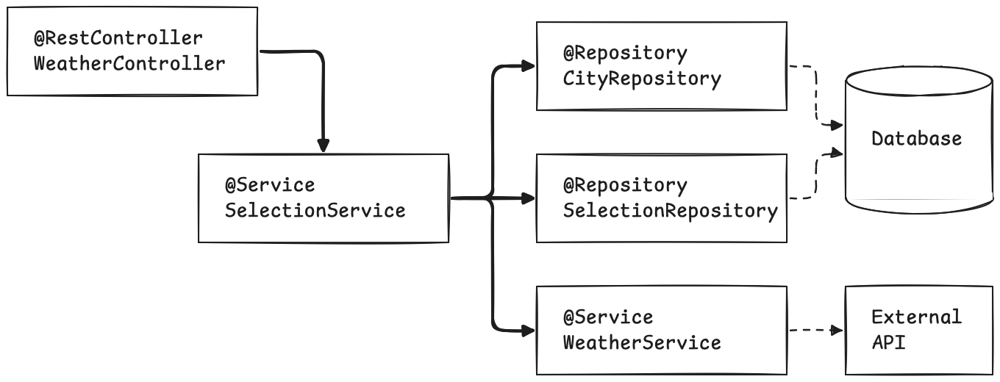

= Testing a Spring Boot "Hello World" application
:source-highlighter: rouge
:icons: font
:tabsize: 2

[.normal]
When you create a project on Spring Initializr, also known as https://start.spring.io, you get testing libraries bundled in, as we mentioned in the previous chapter.
There is also one test file, already written, bundled in your project.
But it contains a single test method, which is empty, and the only thing it validates is that the application can start.
This has value in and on itself.
With Spring, you can write declarative code that express your dependency graph, and any error in your setup, such as a circular dependency, will go unnoticed until you actually run the application.
Similarly, with Spring Boot, the convention-over-configuration programming model enables certain features by adding properties, and configuration errors are only discovered when the application starts.
Having a test that runs the application will verify that the app starts at a click of a button... and it is the most Spring Boot can do: the only thing Spring Initializr knows about your application is that it is a Boot application.
Having this test file makes it easy to add your own tests, without too much to decide: the next logical step is to add another method to this test file, and start from there.

It's a good start, but where do you go from here?
When writing "integration" tests, there a few key points that structure how your test suite will look like:

- What is the API your test uses, how does it interact with your code?
- How do you verify that the state is consistent with the actions of the user?
- How do you keep you factor in the inevitable repetition that comes from test cases?
- Lastly, and most importantly: how do you avoid reaching out to dependencies outside the scope of your code, such as external web services?

In this chapter, we will look at a very basic application, and work through what Spring Boot Test has to offer to answer these questions.

== Getting up and running: a sample application

Before you add tests, you need _something_ to test.
Even if you did test-driven development, you would need to decide _what_ you are going to build before writing tests.
This book is about writing tests, so we will not be explaining how to build the applications we test.
You will find them at **TODO**.
You need Java 21, the latest LTS version, to run the examples.

For this example we will use a simple application that displays the weather and temperature for cities.
The user can select the cities they want in their dashboard, and the weather is fetched in real time from https://open-meteo.com.

[NOTE]
The applications in this book are example applications and are not meant to be production-grade apps.
As such, there might be shortcuts taken here and there, and some best practices may be overlooked.
Please take them with a grain of salt.

First, get the source code at: **TODO**.

Then run the application:

----
./mvnw spring-boot:run
----

In this mode, the application uses weather data from the Open-Meteo API.
If you'd like the application to run locally, you can use a "fake" API that returns random weather, by running it with the `local` profile:

----
./mvnw spring-boot:run -Dspring-boot.run.profiles=local
----

Here's what the application looks like:

image::../images/ch2-fig2.png[]

The user can type a city of their choice in the input box below "add a new city".
The input box auto-completes using an HTML `<datalist>` element on the page, with all 5000 available cities loaded when the page is loaded.
When they click the "Add City" button, the selected city is added to the cards below, and displays the temperature, wind speed and weather at the location.
Cards are order by city name.
The user can click a "remove" button do un-select a city.

On the technical side, this application was created wit the Spring Initalizr at https://start.spring.io.
The following dependencies are included:

[source,xml]
----
include::../samples/ch2/weather/pom.xml[tags=dependencies;!ignored]
----

<1> Spring WebMvc to serve HTTP requests.
<2> Spring Data to store data in a database.
<3> H2 as an in-memory SQL database.

There is no security in the application, and no user management: it is assumed there is a single user.

On the architecture side, nothing out of the extraordinary:

There a single `@Controller`, passing HTTP requests to a single `@Service`.
The service aggregates results from three components:

- The first is a `CityRepository` which contain the list of known cities with their latitude and longitude.
They are displayed in the auto-complete box in the "add a new city" section of the website.
- The `SelectionRepository` contains the list of cities that the user has selected.
For each item in this database table, they a card is displayed on the page.
- The `WeatherService` returns weather data given latitude and longitude coordinates.
By default, the implementation is the `OpenMeteoWeatherService`, makes HTTP calls to the Open-Meteo API.
Note that, when using the `local` profile, the  `RandomWeatherService` will be loaded instead, but we'll leave this out of the scope for now.

[NOTE]
Take the time to run the application and try it out.
Familiarity with the concepts will make the tests much easier to write.

== Running the base test

As we mentioned earlier in the chapter, when you generate a project with Spring Initializr, you get an empty test.

[source,java]
----
include::../samples/ch2/weather/src/test/java/wf/garnier/spring/boot/test/ch2/weather/WeatherApplicationTests.java[tag=content]
----

You can run the test in many ways. The samples use Maven, so, from the root of the repository, run the `./mvnw test` command in a terminal on Linux or macOS systems, or `mvnw.bat test` on Windows systems. The output of the tests look like so:

----
[INFO] Scanning for projects...
[INFO]
[INFO] --------< wf.garnier.spring.boot.test.ch2.weather:weather >---------
[INFO] Building Weather App 0.0.1-SNAPSHOT
[INFO]   from pom.xml
[INFO] ------------------------------[ jar ]-------------------------------

[... omitted for brevity ...]

[INFO] -----------------------------------------------------------
[INFO]  T E S T S
[INFO] -----------------------------------------------------------

[... omitted for brevity ...]

[INFO] Running wf.garnier.spring.boot.test.ch2.weather.WeatherApplicationTests
2025-04-19T16:03:05.011+02:00  INFO 23461 --- [Weather App] [           main] t.c.s.AnnotationConfigContextLoaderUtils : Could not detect default configuration classes for test class [wf.garnier.spring.boot.test.ch2.weather.WeatherApplicationTests]: WeatherApplicationTests does not declare any static, non-private, non-final, nested classes annotated with @Configuration.
2025-04-19T16:03:05.012+02:00  INFO 23461 --- [Weather App] [           main] .b.t.c.SpringBootTestContextBootstrapper : Found @SpringBootConfiguration wf.garnier.spring.boot.test.ch2.weather.WeatherAppplication for test class wf.garnier.spring.boot.test.ch2.weather.WeatherApplicationTests
2025-04-19T16:03:05.013+02:00  INFO 23461 --- [Weather App] [           main] o.s.b.d.r.RestartApplicationListener     : Restart disabled due to context in which it is running

  .   ____          _            __ _ _
 /\\ / ___'_ __ _ _(_)_ __  __ _ \ \ \ \
( ( )\___ | '_ | '_| | '_ \/ _` | \ \ \ \
 \\/  ___)| |_)| | | | | || (_| |  ) ) ) )
  '  |____| .__|_| |_|_| |_\__, | / / / /
 =========|_|==============|___/=/_/_/_/

 :: Spring Boot ::                (v3.4.3)

[... omitted for brevity ...]

[INFO] Tests run: 1, Failures: 0, Errors: 0, Skipped: 0, Time elapsed: 0.399 s -- in wf.garnier.spring.boot.test.ch2.weather.WeatherApplicationTests
[INFO]
[INFO] Results:
[INFO]
[INFO] Tests run: 1, Failures: 0, Errors: 0, Skipped: 0
[INFO]
[INFO] --------------------------------------------------------------------
[INFO] BUILD SUCCESS
[INFO] --------------------------------------------------------------------
[INFO] Total time:  6.480 s
[INFO] Finished at: 2025-04-19T16:03:05+02:00
[INFO] --------------------------------------------------------------------
----

== Adding your first test

== Accessing context dependencies

xx

== Factoring common setup with JUnit

xx

== Decoupling from external dependencies with mocks

xx

== A word of caution: when NOT to use `@SpringBootTest`

xx

// ### 2. Testing a Spring “Hello world”
//
// In this chapter, we will work through a simple example, and showcase some of the testing features bundled in your Spring application when you create it on the Spring Initializr website at [https://start.spring.io](https://start.spring.io)
//
// 1. Getting up and running with code from start.spring.io
// 2. Creating a sample application and adding our first tests
// 3. Decoupling from external dependencies with mocks
// 4. Factoring common setup with JUnit
// 5. Deciding when (not) to use @SpringBootTest