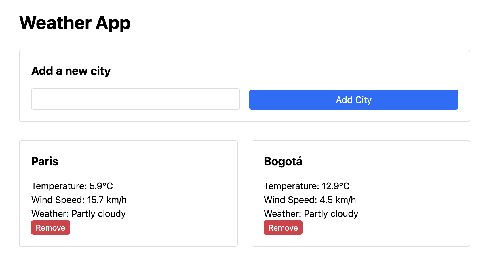

= Testing a Spring Boot "Hello World" application
:source-highlighter: rouge
:icons: font
:tabsize: 2

[.normal]
When you create a project on Spring Initializr, also known as https://start.spring.io, you get testing libraries bundled in, as we mentioned in the previous chapter.
There is also one test file, already written, bundled in your project.
But it contains a single test method, which is empty, and the only thing it validates is that the application can start.
This has value in and on itself.
With Spring, you can write declarative code that express your dependency graph, and any error in your setup, such as a circular dependency, will go unnoticed until you actually run the application.
Similarly, with Spring Boot, the convention-over-configuration programming model enables certain features by adding properties, and configuration errors are only discovered when the application starts.
Having a test that runs the application will verify that the app starts at a click of a button... and it is the most Spring Boot can do: the only thing Spring Initializr knows about your application is that it is a Boot application.
Having this test file makes it easy to add your own tests, without too much to decide: the next logical step is to add another method to this test file, and start from there.

It's a good start, but where do you go from here?
When writing "integration" tests, there a few key points that structure how your test suite will look like:

- What is the API your test uses, how does it interact with your code?
- How do you verify that the state is consistent with the actions of the user?
- How do you keep you factor in the inevitable repetition that comes from test cases?
- Lastly, and most importantly: how do you avoid reaching out to dependencies outside the scope of your code, such as external web services?

In this chapter, we will look at a very basic application, and work through what Spring Boot Test has to offer to answer these questions.

== Getting up and running: a sample application

Before you add tests, you need _something_ to test.
Even if you did test-driven development, you would need to decide _what_ you are going to build before writing tests.
This book is about writing tests, so we will not be explaining how to build the applications we test.
You will find them at **TODO**.

For this example we will use a simple application that displays the weather and temperature for cities.
The user can select the cities they want in their dashboard, and the weather is fetched in real time from https://open-meteo.com.

[NOTE]
The applications in this book are example applications and are not meant to be production-grade apps.
As such, there might be shortcuts taken here and there, and some best practices may be overlooked.
Please take them with a grain of salt.

Here's what the application looks like:

The architecture is fairly basic.

== Adding your first test

xx

== Accessing context dependencies

xx

== Factoring common setup with JUnit

xx

== Decoupling from external dependencies with mocks

xx

== A word of caution: when NOT to use `@SpringBootTest`

xx

// ### 2. Testing a Spring “Hello world”
//
// In this chapter, we will work through a simple example, and showcase some of the testing features bundled in your Spring application when you create it on the Spring Initializr website at [https://start.spring.io](https://start.spring.io)
//
// 1. Getting up and running with code from start.spring.io
// 2. Creating a sample application and adding our first tests
// 3. Decoupling from external dependencies with mocks
// 4. Factoring common setup with JUnit
// 5. Deciding when (not) to use @SpringBootTest